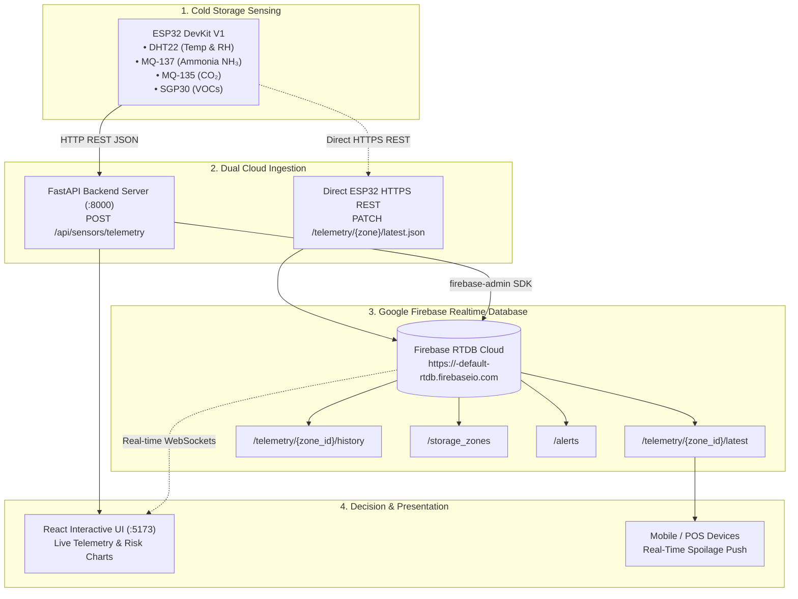

# Firebase Realtime Database Integration Guide
## AI & IoT-Based Smart Restaurant Management System (J26-IT-333)
**Component 3**: Multi-Modal Food Spoilage Prediction & Cold Storage Environmental Telemetry  
**Author**: Maddumage M. S. (`IT23348820`)  

---

## 🌐 1. System Architecture with Firebase

Your system now natively supports **Google Firebase Realtime Database (RTDB)** for ultra-low latency, cloud-synced environmental telemetry and spoilage alerts.



---

## ⚡ 2. Step-by-Step Setup in Firebase Console (3 Minutes)

Follow these simple steps to set up your free Google Firebase Realtime Database:

### Step 1: Create a Project in Firebase Console
1. Open your browser and go to: [**https://console.firebase.google.com/**](https://console.firebase.google.com/)
2. Sign in with your Google account.
3. Click **"Add project"** (or "Create a project").
4. Enter a project name, e.g., `smart-restaurant-j26`.
5. You can disable Google Analytics for now, then click **"Create project"**.

---

### Step 2: Create the Realtime Database
1. Once inside your new project dashboard, look at the left sidebar under the **Build** menu.
2. Click **Realtime Database**.
3. Click the **"Create Database"** button.
4. Select a database location (e.g., `United States (us-central1)` or `Singapore (asia-southeast1)`). Click **Next**.
5. Select **"Start in test mode"** (this allows read & write access for 30 days during development/presentations).
6. Click **Enable**.
7. **Copy your Database URL** shown at the top of the Data tab (it looks like: `https://smart-restaurant-j26-default-rtdb.firebaseio.com/`).

---

### Step 3: Generate the Service Account Key (`firebase_service_account.json`)
1. In the Firebase Console, click the **Gear icon ⚙️** (Project Settings) at the top of the left sidebar.
2. Go to the **"Service accounts"** tab.
3. Under *Firebase Admin SDK*, ensure **Python** is selected.
4. Click the **"Generate new private key"** button.
5. Click **"Generate key"** in the popup confirmation.
6. A `.json` file will download to your computer.
7. **Rename that file to `firebase_service_account.json`** and move it into your project folder:
   ```
   Research Project/backend/firebase_service_account.json
   ```

---

### Step 4: Configure `backend/.env`
Open `backend/.env` in your editor and paste your Database URL:
```env
FIREBASE_DATABASE_URL=https://smart-restaurant-j26-default-rtdb.firebaseio.com/
FIREBASE_CREDENTIALS_PATH=firebase_service_account.json
```
*(Replace `smart-restaurant-j26-default-rtdb.firebaseio.com` with your exact Firebase URL from Step 2).*

---

## 🧪 3. How to Test & Verify Firebase Connection

### 1. Verify Connection Status via API
Start your backend or run this command:
```powershell
python -c "from app.services.firebase_service import firebase_service; print(firebase_service.get_status())"
```
You will see:
```json
{
  "connected": true,
  "database_url": "https://your-project-default-rtdb.firebaseio.com",
  "credentials_found": true,
  "mode": "Live Firebase Realtime Database"
}
```

Or visit in your browser:
```
http://localhost:8000/api/sensors/firebase/status
```

---

### 2. Sync Initial Storage Zones to Firebase
Run this command or call the endpoint to push all 5 storage chambers to Firebase:
```powershell
python -c "import requests; r = requests.post('http://localhost:8000/api/sensors/firebase/sync'); print(r.json())"
```
Open your Firebase Console Realtime Database tab—you will see `/storage_zones` appear with all chambers and optimal thresholds!

---

### 3. Stream Live Telemetry into Firebase
Run the presentation hardware bridge simulator:
```powershell
python iot_firmware/esp32_hardware_bridge.py --simulate
```
In your Firebase Console, you will watch the data tree light up with **green highlights** in real time as packets flow into:
- `/telemetry/zone-fruit/latest`
- `/telemetry/zone-fruit/history`

---

## 📱 4. Direct ESP32 to Firebase Mode (No PC Needed)

If you want the physical ESP32 to stream directly to Firebase Realtime Database without needing your laptop or local backend running:

1. Open [`iot_firmware/esp32_firebase_direct_monitor.ino`](file:///c:/Users/Asus/Desktop/PROJECTS/Research%20Project/iot_firmware/esp32_firebase_direct_monitor.ino) in Arduino IDE.
2. Fill in your Wi-Fi details:
   ```cpp
   const char* WIFI_SSID     = "Your_WiFi";
   const char* WIFI_PASSWORD = "Your_Password";
   const char* FIREBASE_HOST = "https://your-project-default-rtdb.firebaseio.com";
   ```
3. Flash the code to the ESP32. It uses lightweight native HTTPS REST calls (`client.setInsecure()`, `https.PATCH()`), requiring **zero extra heavy Arduino libraries**.

---

## 🔒 5. Security & Git Safeguards

- `firebase_service_account.json` and `.env` are automatically protected by [`.gitignore`](file:///c:/Users/Asus/Desktop/PROJECTS/Research%20Project/.gitignore) so your private keys are never pushed to GitHub.
- If Firebase credentials are not found, the system runs smoothly in **Local Standalone Mode** with zero crashes.
